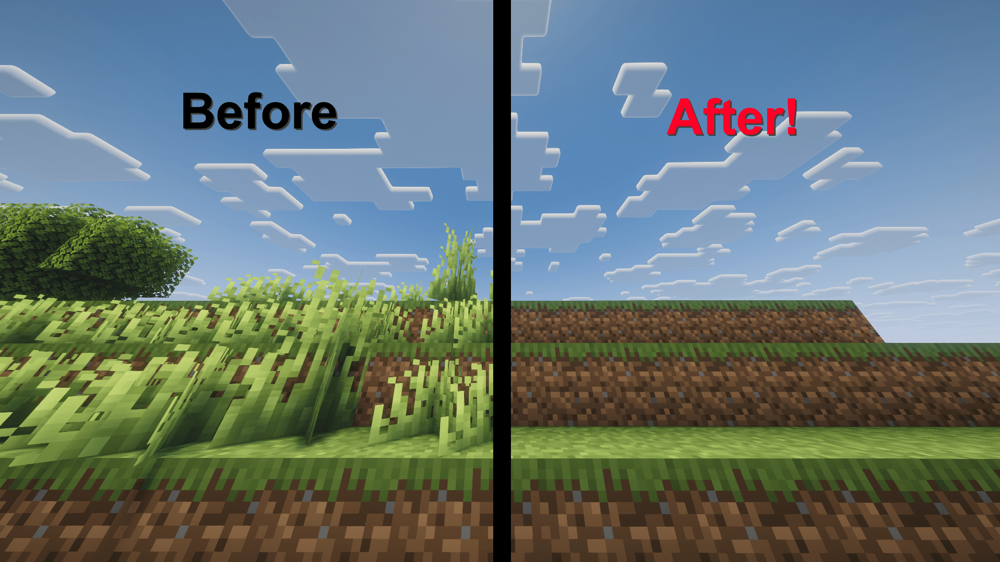

This mod removes grass generation in Minecraft.

Requires Fabric API.

This mod removes grass generation. Bone meal continues to work because the mod removes the generation of grass, while the grass itself remains in the game, so it can still be grown artificially. So you don't need to worry, and you can still tell your friends to go touch grass.

This mod also restricts the generation of the following: short grass, tall grass, fern, large fern, short dry grass, tall dry grass, dead bush, grass, bush, firefly bush, leaf litter, crimson roots, warped roots, nether sprouts, red shrub, seagrass, tall seagrass, kelp, kelp plant.

The mod should be compatible with most mods because it doesn't remove plants from the game, it only removes their generation.

